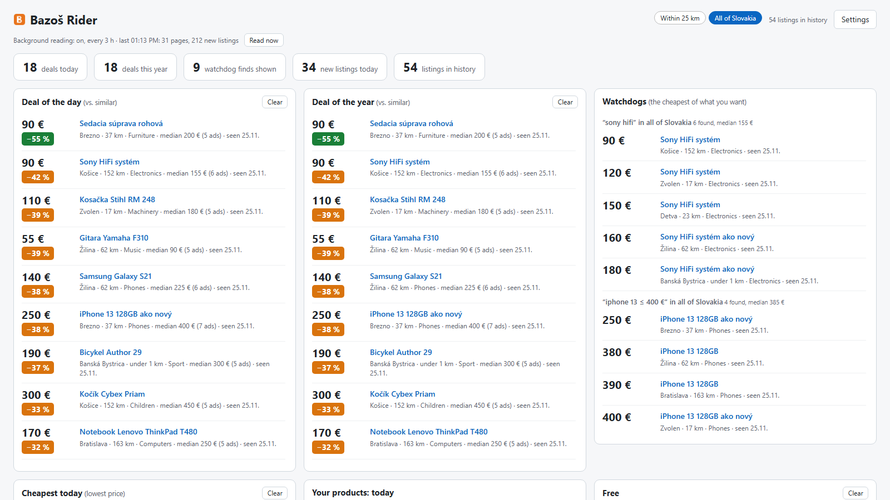
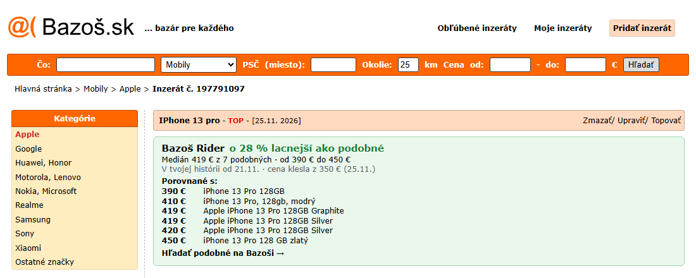

# Bazoš Rider

**Hide what you don't want on bazos.sk. See what's cheap without researching it.**

Bazoš search results are long, mixed and hard to scan. Bazoš Rider hides the
sections and words you never want to see, remembers the prices of everything
you scroll past, and tells you which listings are cheap compared with the
similar ones you have already seen.

All of it happens in your browser, from pages you open yourself.

  

---

## What it does

**Reads Bazoš for you, if you let it.** Switch on *Nastavenia → Čítanie
Bazoša na pozadí* and Bazoš Rider reads the newest pages of every section you
have not hidden, every 3 hours (one page every 1.5 seconds, section pages only, and after the first time only what is new).
Open the popup and today's deals are there, without browsing Bazoš.
*Prečítať teraz* reads at once.

**A dashboard.** *⤢ Prehľad* opens the lists in a whole tab: deals of the
day and the year, watchdogs and today's cheapest side by side.

**Watchdogs.** Tell it what you are looking for, "sony hifi" in Elektro, and
the popup's *Strážcovia* shows the 5 cheapest near you, or in all of Slovakia
(the header switch decides), with the median of everything it found.

**Near you or all of Slovakia.** Enter your postal code once; every listing
shows its town and distance ("Zvolen · 17 km"), and the header switch *V okolí
25 km / Celé Slovensko* filters every list.

**Shows the good deals the moment a page opens.** A bar above the results
says *3 výhodné ponuky na tejto strane: −42 % −31 % −25 %*; each number
scrolls to its listing. The deals themselves get a green edge, and the
add-on's toolbar icon shows how many there are. Two switches in the bar:
*Len výhodné* fades everything else out, *Zoradiť podľa zľavy* puts the
biggest discount first. "Good" means at least 15 % under the median of
similar listings; change it under *Nastavenia → Na stránke Bazoša*.

**Goes through the rest of the search on request.** *Prejsť ďalších 10 strán*
reads the next pages of the section you are on, one every 1.5 seconds, and
lists the good deals it found there. Click again to continue with the 10
after those. On search results it is not offered: Bazoš asks programs not to
read those. It also fills the price history, so the
first visit to a new kind of item already has something to compare with.

**Checks the price of any listing you open.** Under the title of a
listing's own page: *o 28 % lacnejší ako podobné* (or *drahší*, or *približne
bežná cena*), the median and range of similar listings, the listings
themselves, and whether this one's price dropped since you first saw it.

  

**Hides listings.** Tick whole sections (cars, jobs, real estate…) or type
words like `na diely`. The bar says how many were hidden, next to Bazoš's own
*next page* link.

**Badges every listing.** Right under the price on Bazoš itself:

| Badge | Means |
|---|---|
| `ZADARMO` | Given away |
| `↓ −200 €` | The price dropped today since you last saw it |
| `−25 % vs. medián (8 inz.)` | Under the median of a product you typed in |
| `−12 % vs. 4 podobných` | Under the median of similar listings found automatically |
| `⚠ −78 % vs. 6 podobných` | So cheap it is more likely a different item, a broken one or a scam. Not counted as a deal |
| `splátky / leasing` | Not recorded: the number is a down payment or an installment |
| `kúpim / hľadám` | Not recorded: someone wants to buy or swap |
| `na diely / nefunkčné` | Not recorded: broken or for parts, it would make working ones look overpriced |

Click a discount badge to see the listings it was compared with and their
prices. If one of them does not belong, the comparison is wrong, and an issue
with both titles helps fix it.

  

**Keeps leaderboards in the popup.**

- **Najlacnejšie dnes**: the five cheapest of today, per category
- **Deal dňa / Deal roka**: the biggest discounts against similar listings,
  today and this year
- **Zadarmo**: free items, per category
- **Ručne zadané produkty**: today's bargains for the products you track

*Vyčistiť* empties a list without touching the history behind it, so
comparisons keep working. An empty deal list says why it is empty.

**Settings are in the popup too.** *Nastavenia* swaps the lists for the
filters, comparison thresholds, your products and the price history.
*Záloha* exports all of it to a file and imports it on another computer.

## How "similar" works

Titles are compared word by word within one Bazoš section, after some
tidying: "128 GB" and "128GB" are one word, "iPhone 13" and "iPhone13" are the
same model, and Slovak endings are ignored ("kočík", "kočíka", "kočíky").

Some things always keep two titles apart:

- **Numbers that disagree.** "iPhone 13" is never compared with "iPhone 15",
  "Octavia 2008" with "Octavia 2015", "1.6 TDI" with "2.0 TDI"
- **A variant on one side only.** "iPhone 13 Pro" is not a cheap "iPhone 13".
  The words are *pro, max, mini, plus, ultra, lite, fe, xl*

*Nastavenia → Automatické porovnávanie* has two modes. *Voľnejšie*, the
default, also groups titles without a model number when they are very alike
("Šaty na stužkovú"). *Prísne* needs a shared model number (`Cybex Priam
2023`, `Samsung QE55Q60`, `iPhone 13`): fewer comparisons, almost never a
wrong one. Brand words alone are never enough, because *Britax Römer* covers
a 60 € seat and a 300 € one.

Or track a product by name under *Ručne zadané produkty*; its median counts
from five listings.

## Install

**From source** — `about:debugging#/runtime/this-firefox` → Load Temporary
Add-on → pick `Firefox/manifest.json`. It unloads when Firefox closes.

Works on Firefox desktop and Firefox for Android (142 or newer).

  

## Privacy

Nothing leaves your browser. No servers, no accounts, no analytics, and no
request to anyone but Bazoš.

Bazoš Rider reads the pages you open. It loads pages itself only when you ask:
background reading, if you switch it on, and *Prejsť ďalších 10 strán*. Both
read only Bazoš section pages, which Bazoš's `robots.txt` allows, never search
results; one page every 1.5 seconds; and background reading stops for a day if
Bazoš ever refuses. Your postal code stays in your browser, and distances are
computed there. See [PRIVACY.md](PRIVACY.md).

Postal code positions: [GeoNames](https://www.geonames.org), CC BY 4.0.

## Add a module

Filters, badges, popup lists and skip rules are each one file. Drop a file into
`src/filters/`, `src/badges/`, `src/lists/` or `src/skip/`, run
`npm run build`, reload. [CONTRIBUTING.md](CONTRIBUTING.md) has a worked
example for each.

## Something broken? An idea?

[Open an issue](../../issues). Saving the Bazoš page (Ctrl+S) and attaching it
is the fastest way to get a wrong badge fixed.

---

Bazoš Rider is an independent project, not affiliated with or endorsed by
Bazoš.sk. MIT licensed — see [LICENSE](LICENSE).
