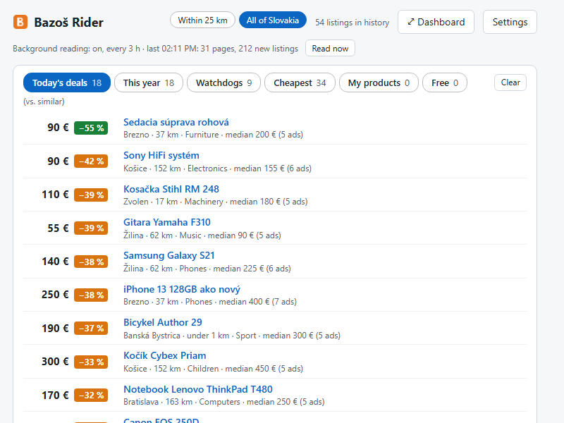
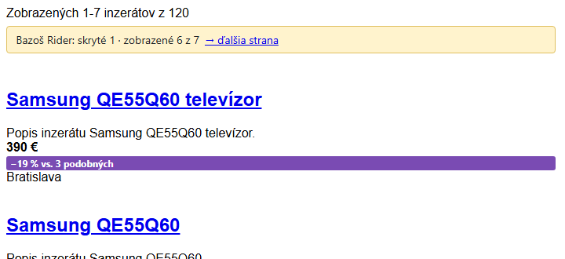
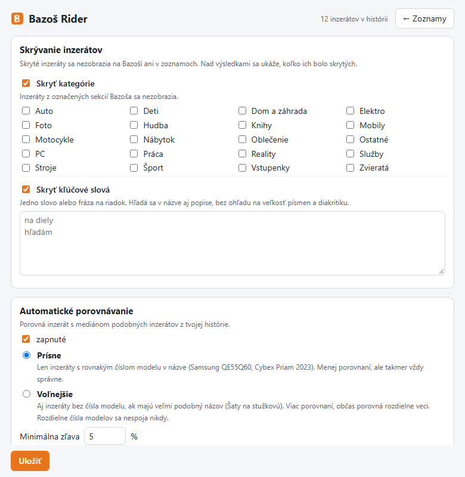

# Bazoš Rider

**Hide what you don't want on bazos.sk. See what's cheap without researching it.**

Bazoš search results are long, mixed and hard to scan. Bazoš Rider hides the
sections and words you never want to see, remembers the prices of everything
you scroll past, and tells you which listings are cheap compared with the
similar ones you have already seen.

All of it happens in your browser, from pages you open yourself.

  

---

## What it does

**Hides listings.** Tick whole sections (cars, jobs, real estate…) or type
words like `na diely`. A banner above the results says how many were hidden,
with Bazoš's own *next page* link, so an emptied page is one click from the
next one.

**Badges the good ones.** Right under the price on Bazoš itself:

| Badge | Means |
|---|---|
| `ZADARMO` | Given away |
| `↓ −200 €` | The price dropped today since you last saw it |
| `−25 % vs. medián (8 inz.)` | Under the median of a product you typed in |
| `−12 % vs. 4 podobných` | Under the median of similar listings found automatically |
| `splátky / leasing` | Not recorded: the number is a down payment or an installment |

  

**Keeps leaderboards in the popup.**

- **Najlacnejšie dnes**: the five cheapest of today, per category
- **Deal dňa / Deal roka**: the biggest discounts against similar listings,
  today and this year
- **Zadarmo**: free items, per category
- **Ručne zadané produkty**: today's bargains for the products you track

*Vyčistiť* empties a list without touching the history behind it, so
comparisons keep working. An empty deal list says why it is empty.

**Settings are in the popup too.** *Nastavenia* swaps the lists for the
filters, comparison thresholds, your products and the price history.

## How "similar" works

Listings are grouped only when their titles share a **model number**:
`Cybex Priam 2023`, `Samsung QE55Q60`, `i30`. Brand and category words alone
are not enough, because *Britax Römer* covers a 60 € seat and a 300 € one, and
comparing them once produced an "−84 %" that was simply wrong. A missing
comparison is better than a wrong one.

Titles whose numbers disagree never group, so "iPhone 13 128GB" is not
compared with "iPhone 15 128GB".

For listings without model numbers (clothes, books, furniture), switch
*Nastavenia → Automatické porovnávanie* to *Voľnejšie*: titles that are very
alike group even without a number. More comparisons, occasionally a wrong one.
Or track a product by name under *Ručne zadané produkty*; its median counts
from five listings.

## Install

**From source** — `about:debugging#/runtime/this-firefox` → Load Temporary
Add-on → pick `Firefox/manifest.json`. It unloads when Firefox closes.

Works on Firefox desktop and Firefox for Android (142 or newer).

  

## Privacy

Nothing leaves your browser. No servers, no accounts, no analytics. The
extension makes no network requests at all: not to the author, not to Bazoš.

It never fetches Bazoš pages in the background either. Bazoš's `robots.txt`
asks automated clients to stay off search pages, and the only data Bazoš Rider
uses is what you load yourself. See [PRIVACY.md](PRIVACY.md).

## Add a module

Filters, badges, popup lists and skip rules are each one file. Drop a file into
`src/filters/`, `src/badges/`, `src/lists/` or `src/skip/`, run
`npm run build`, reload. [CONTRIBUTING.md](CONTRIBUTING.md) has a worked
example for each.

## Something broken? An idea?

[Open an issue](../../issues). Saving the Bazoš page (Ctrl+S) and attaching it
is the fastest way to get a wrong badge fixed.

---

Bazoš Rider is an independent project, not affiliated with or endorsed by
Bazoš.sk. MIT licensed — see [LICENSE](LICENSE).
